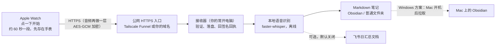

# 小鹿录音 · xiaolu-watch

在 Apple Watch 上点一下开始录音，手表自动分段，有网就直接上传到你自己的电脑，用本地模型转成文字，存进 Obsidian（或任意文件夹）。不用每天导出，也不用按时长付费调用云端 API。

> 这是一个个人开源项目，不是 App Store 应用。你需要用自己的 Apple ID 在 Xcode 里编译并装到自己的手表上。核心链路已在作者的 Apple Watch Series 9 上跑通，其余部分哪些验证过、哪些没验证过，见下方[已验证与限制](#已验证与限制)。

## 它怎么工作



- 手表负责录音和排队。电脑不在线时，录音留在手表上等着，不会丢。
- 只有接收器收到、验证并写入磁盘后，手表才把这一段标为“已送达”；这只代表原音保存好了，转写和写笔记是之后的独立步骤。
- 没说话的片段（静音、环境声）会被识别为“无语音”，不会生成空笔记。
- 每个有语音的约 60 秒片段生成一篇 Markdown，带日期、来源 ID 和时间戳。
- 可选的双版本文字层正在接入：把相邻转写整理成每日“口语清稿”和“七删一改整理稿”，正文隐藏机器标识；启用时会向 DeepSeek 官方 API 发送转写文字并产生文字处理费用。配置、原文保留和验收边界见[双版本输出](docs/dual-text-output.md)。
- iPhone 只用于把 App 装到手表上（手表 App 必须随 iPhone App 一起安装），不负责中转录音。

## 两种部署方式，选一种

| | 常开的 Windows 电脑（作者实测方案） | 常开的 Mac |
| --- | --- | --- |
| 谁接收和转写 | Windows：接收 + 本地转写 + 生成笔记 | Mac：接收 + 本地转写 + 直接写进 Vault |
| 笔记怎么进 Obsidian | 先存在 Windows；Mac 开机联网后自动拉进 Mac 的 Vault（也可以直接写进 Windows 上的 Vault） | 直接写入 |
| 适合 | 有一台常开、最好带 NVIDIA 显卡的 Windows 电脑；Mac 不常开 | Mac 本身常开（如 Mac mini） |
| 转写速度 | NVIDIA 显卡可用 large-v3-turbo，很快 | faster-whisper 在 Mac 上只能用 CPU，建议 small，较慢 |
| 验证状态 | 真手表 → Windows → 转写 → Mac Obsidian 已跑通 | **未经真机验收**：代码相同，作者只用模拟上传在 Mac 上跑通了接收→转写→笔记，没有用真手表直传 Mac 验收过 |

两种方式用同一个手表 App 和同一套加密上传协议，之后可以换。

## 快速开始：把仓库丢给你的 Agent

最省事的用法：把这个仓库交给 Claude Code、Codex 等 AI 编程助手，让它按 [AGENTS.md](AGENTS.md) 帮你装。它会先问你几个选择，再按你的选择执行。可以直接这样说：

```text
请帮我安装 https://github.com/xiaolu-ai26/xiaolu-watch 。
先读仓库里的 AGENTS.md，按里面的流程先问我选择，再一步步执行。
需要我自己在界面上操作（Xcode 登录、手表配对、开开发者模式）的时候停下来告诉我怎么做。
```

想自己动手，也只有几步：

```bash
git clone https://github.com/xiaolu-ai26/xiaolu-watch.git
cd xiaolu-watch
python3 scripts/setup.py        # 交互式向导：每一步都给选项和推荐值
python3 scripts/doctor.py       # 检查整条链路，告诉你哪里还没好
python3 scripts/pair.py         # 生成手表一次性配对码（10 分钟有效）
```

向导会问你：接收端用 Mac 还是 Windows、笔记放哪（会自动列出你电脑上的 Obsidian Vault）、要不要飞书（默认不要）、网络入口用 Tailscale Funnel 还是自己的 HTTPS 域名、语音识别用显卡还是 CPU（自动检测并推荐模型大小）、你的 Apple 开发团队。然后它生成全部配置和后台服务文件；配对密钥只生成在本机的 `data/` 目录，不会进仓库。

手表 App 的编译安装和配对见 [docs/apple-build.md](docs/apple-build.md)。

## 你需要准备

- Apple Watch（watchOS 10 及以上的部署目标；作者实测 Series 9 / watchOS 27）和配对的 iPhone。
- 一台 Mac + 完整 Xcode，用来编译安装 App（Xcode 版本要支持你手表的系统，见[排障](docs/troubleshooting.md)）。Apple ID 即可签名，免费的 Personal Team 也能装到自己的设备，有效期和设备数以 Xcode 显示为准。
- 一台常开的接收电脑（Windows 或 Mac），装 Python 3.10+ 和 FFmpeg。
- 一个公网 HTTPS 入口：推荐免费的 [Tailscale Funnel](https://tailscale.com/kb/1223/funnel)；也可以用自己的域名和反向代理。
- 磁盘：手表编码后约 14 MB/小时（AAC 32 kbps）。接收端会保留原音，并在转写队列里再存一份，按每小时约 30–45 MB 预估。

## 已验证与限制

**已在作者的设备上验证（单台 Apple Watch Series 9，当次样本，不代表所有网络和设备）：**

- 点开始后回到表盘、熄屏，App 继续录音并按约 60 秒自动分段；连续三个完整分段由手表直接上传，都拿到接收端的签名持久回执。三段从安排上传到收到回执分别约 4.2、2.4、3.9 秒，这是当次网络下的样本，不是延迟保证，也不含转写时间。
- 前两段有声片段完成本地转写并写入 Obsidian，第三段判为无语音、没有生成空笔记。
- 一次旧版本会话连续录音 23 分 44 秒、共 24 段，停止后自动补传成功：12 段有声完成处理，12 段无语音，零失败。
- Windows 接收端（NVIDIA RTX 3060 6GB 笔记本显卡，large-v3-turbo，int8_float16）+ Tailscale Funnel + Mac 定时拉取进 Obsidian 的完整链路。
- iPhone 不开 Tailscale、继续用自己已有的 VPN，手表照样经 Funnel 上传。
- 零输入首次配对：在 Mac 上用 Xcode 工具把短期配对文件投递进手表 App，App 自行通过 HTTPS 领取长期配置。

**还没有验证，或者明确做不到的：**

- 24 小时连续录音的续航与发热。
- 真实断网后的自动恢复（只验证过接收端故障期间手表持续重试、恢复后补传）。
- 来电、Siri、闹钟等系统音频中断后的恢复。
- 强制退出 App 或手表重启后，需要你重新点“开始”；不会自动续录。
- 没有每天定时自动开录。
- 上传进行中按停止的交接、冷重启后的任务恢复。
- Mac 作为接收端：未经真机验收（见上表）。
- 在手表上手动输入地址和配对码：代码已实现并通过审查，未在真机上实测。
- 用 iPhone 扫码把配置下发给手表：作者测试时配置没有送达手表，不推荐作为首选。
- `setup.py` 的 Windows 分支和生成的 Windows 计划任务脚本、Linux 接收端：未在干净环境实测。
- 转写准确率没有做人工基准测试；机器转写可能有错字、同音字，或输出繁体字。不识别说话人。

## 隐私与安全

- 录音只上传到你自己的接收电脑。音频和元数据在 HTTPS 之外再用 AES-256-GCM 加密，接收端的回执用 HMAC 签名并绑定每次请求；拿不到配对密钥的中间人既看不到原音，也伪造不了“已保存”。
- 配对密钥、原音、数据库、转写和日志都在 `data/`（已被 `.gitignore` 忽略）。配对码一次性、10 分钟过期，服务器只存它的哈希。
- 公网入口只转发加密上传和配对认领两个接口，没有文件下载、目录浏览或管理接口。
- 转写全程本地离线；模型只在安装时下载一次。
- 可选文字整理使用云端 DeepSeek；启用后会发送转写文本及有限上下文，音频识别仍在本地。完整链路此时不是完全离线。
- 请让对话者知情，并遵守当地关于录音的法律。

## 目录

```text
apple/WatchMemory/   手表 App、iPhone 伴侣 App、共享 Swift 核心（XcodeGen 工程定义）
receiver/            接收器、loopback HTTPS 入口、一次性配对
processor/           本地语音识别、笔记流水线、Windows→Mac 笔记拉取
scripts/             setup（配置向导）、doctor（体检）、pair（配对码）、deliver_onboarding（零输入投递）、service（服务入口）
docs/                部署、App 编译安装、排障、加密协议
```

## 文档

- [docs/deployment.md](docs/deployment.md)：两种接收端的部署、HTTPS 入口、后台服务、显卡、存储与回滚
- [docs/dual-text-output.md](docs/dual-text-output.md)：可选口语清稿、七删一改、DeepSeek 费用边界与双版本输出
- [docs/apple-build.md](docs/apple-build.md)：编译安装手表 App、首次配对
- [docs/troubleshooting.md](docs/troubleshooting.md)：Xcode 连不上手表、VPN 冲突等真实踩坑
- [docs/wire-v2.md](docs/wire-v2.md)：加密上传协议 v2
- [apple/WatchMemory/README.md](apple/WatchMemory/README.md)：App 录音、分段、上传、保留策略的设计

## 许可证与第三方

本项目代码以 [MIT 许可证](LICENSE) 发布，版权人 xiaolu-ai26。

仓库不包含第三方代码、二进制、模型或录音。依赖由你在安装时自行获取，各自遵循其许可证：Python 依赖见 `requirements*.txt`（cryptography：Apache-2.0 或 BSD；faster-whisper、CTranslate2：MIT；tzdata：Apache-2.0）；Whisper 系列模型权重从 Hugging Face 下载（OpenAI Whisper 为 MIT，具体以模型页为准）；FFmpeg、XcodeGen、Tailscale、lark-cli 由你另行安装。App 的设计参考来源见 [apple/WatchMemory/PROVENANCE.md](apple/WatchMemory/PROVENANCE.md)。测试用音频在运行测试时由 FFmpeg 现场合成。

## English

**xiaolu-watch** turns an Apple Watch into a tap-to-start recorder that splits audio into ~60 s chunks, uploads them directly from the watch to *your own* always-on computer over HTTPS (with an extra AES-GCM + signed-receipt layer), transcribes locally with faster-whisper and writes Markdown notes into Obsidian or any folder. No daily exports, no per-minute cloud ASR. Pick a Windows receiver (the author's tested setup; notes are pulled into Obsidian on a Mac when it is online) or a Mac receiver (same code, **not yet verified with a real watch**). Feishu/Lark publishing is optional and off by default. Start with `python3 scripts/setup.py`, or hand the repo to your coding agent and point it at [AGENTS.md](AGENTS.md). You build and sign the watch app yourself with Xcode and your Apple ID. Verified so far on one Apple Watch Series 9: background recording with direct upload of consecutive segments and a 24-segment backlog upload; not yet verified: 24 h battery life, real network loss recovery, call/Siri interruption recovery; recording does not auto-restart after a force quit or reboot. MIT licensed.
