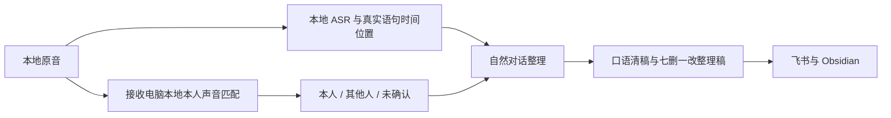

# 自然对话整理与本人声音识别

当前源码与隔离验证已完成，生产部署状态以接收端回执为准。代码存在、模型成功加载、真实录音处理、飞书和 Obsidian 入库属于不同验收阶段，不能互相代替。

## 使用体验

手表照常录音，不增加重点标记按钮，也不要求每次说话时手动分段。后台将转写按内容连续性组织成自然主题，继续输出口语清稿和七删一改整理稿。两份稿件保留原话中的不确定、跳跃想法和粤语表达。

## 对话如何划分

一分钟音频文件是传输单位，文字处理窗口是费用和资源控制单位，二者都不直接等于一段对话。程序使用 ASR 已有的语句位置建立本地来源记录，再将文字、有限前文、停顿线索和归属标签交给同一次文字整理请求。

模型按真实内容分组；说话人变化不自动开启新主题，同一个人也可以换题。返回结果必须按顺序完整覆盖输入语句，每个语句只能出现一次，不允许遗漏、重复或重排。时间和身份不由文字模型生成。

跨窗口延续同一个主题时，只追加新内容，显示为对应主题的续篇；不反复改写已经发布的旧正文。原有文字模型档位、请求预算和录音起始过滤设置继续适用。自然分组仍可能判断错误，不能据此宣称已识别全部真实对话边界。

## 本人声音识别

模型选择以腕上真实录音的匹配质量为先，在常开的接收电脑上运行。Windows 接收端可评估 NVIDIA GPU 模型；CPU 模型作为可选回退，不把轻量或加载成功当成质量已经合格。本次质量优先候选为 WeSpeaker ResNet293-LM，开发设备已验证其网络计算实际使用 CUDA，并完成本人确认样本的注册与独立保留窗口检查。此检查只说明该样本可用于接入，不代表跨环境识别准确率。最终模型修订、权重校验与推理设备仍由实际部署记录固定；Mac 只负责开发与笔记同步时，不承担声纹推理。

当前接入使用 ONNX Runtime CUDA 和 kaldi-native-fbank；模型权重与推理库分别遵循各自许可证：

- [WeSpeaker ResNet293-LM 官方模型卡](https://huggingface.co/Wespeaker/wespeaker-voxceleb-resnet293-LM)：CC-BY-4.0。权重不随本仓库分发，下载和使用时应保留原作者归属信息。
- [ONNX Runtime LICENSE](https://github.com/microsoft/onnxruntime/blob/main/LICENSE)：MIT。
- [kaldi-native-fbank LICENSE](https://github.com/csukuangfj/kaldi-native-fbank/blob/master/LICENSE)：Apache-2.0。

公开权重可以下载，不代表已验证普通话、粤语、混说和嘈杂腕上录音。接入的标签文件必须匹配配置中固定的模型 ID、权重 SHA-256、模型修订、本人注册版本和配置文件 SHA-256，不能只按名称信任结果。GPU 的作用是执行推理，不据此宣称识别准确率更高。

先完成一次本人注册：由用户确认一段确实只有本人讲话的录音作为样本。不能根据转写里出现“我”或姓名自动注册，也不能把任意历史片段当成本人。注册后的匹配在接收电脑本地执行。

输出只表示以下三种归属：

| 标签 | 含义 |
| --- | --- |
| `self` | 当前片段满足与已确认本人样本匹配的规则 |
| `other` | 当前片段满足低于本人匹配范围的规则；不识别对方姓名 |
| `unknown` | 证据不足，保留未确认，不强行归属 |

短语音、音量过低、削波、子片段不一致、已发现的重叠或证据不匹配，都可能得到 `unknown`。本人标签仅作为文字整理上下文，不把其他人或未确认的话删除，也不自动生成用户待办。

这是辅助归属功能，不是身份认证、活体检测或多人声源分离。播放本人录音可能造成匹配；多人重叠也不保证被检测出来。相似度不是准确率或概率，默认规则不等于已经对某个用户校准完成。

## 隐私与失败行为

声纹向量、本人注册样本、匹配分数和模型版本记录留在本地私有文件。Windows 部署应使用运行账号的 `LocalAppData` 私有目录并限制 ACL，不能放到公开 Git 仓库或同步笔记目录。

文字整理接口只接收允许的文字字段、归属标签和停顿线索，不发送音频、声纹向量、匹配分数或精确时间位置。正文只显示“疑似本人讲话”“包含未匹配本人的声音”或“归属未确认”等可读的估计提示；来源定位和校验信息保存在私有附属记录中。

模型或本人配置未就绪、证据缺失或校验失败时，归属退回未确认。等待声纹结果有时间上限，不让它无限阻塞已有转写和文字整理。原音与原始转写继续保留。

## 验收与历史资料

优先用启用时间之后的新录音验证自然输出。若没有新录音，旧样本只用于私有、隔离的测试，不重发到飞书或 Obsidian。注册验证、隔离样本结果和后续真实新录音入库应分别记录，不能互相替代。

本功能尚未提供经验证的一键安装入口。独立声纹任务使用 `processor/speaker_worker.py --config <私有配置>`，一次性注册使用同一入口加 `--enroll-plan <已明确授权的私有样本计划>`。注册计划必须明确来源、互不重叠的注册与保留窗口，以及公开不同声音的对照；不得自动选择最大说话人簇充当本人。不要自行修改数据库或阈值来让片段变成“本人”。

文字整理继续使用 `text_worker.py --config`。可选配置增加 `conversation_mode` 和 `conversation_pause_seconds`；后者只用于决定何时提交处理窗口，不是硬性话题边界。可选 `speaker` 配置包含 `outbox`、`profile_version`、`model_id`、`model_revision`、`model_sha256`、`profile_sha256` 和 `wait_seconds`（0–60 秒），固定预期的本人配置和模型。缺少任何必要绑定时直接使用未确认；配置完整但结果暂缺时有界等待，超时保留文字并退回未确认。依赖见 `requirements-speaker.txt`；应在独立环境安装，CUDA 库仍需与 ONNX Runtime 的官方兼容要求匹配。CPU 回退应单独选择对应环境，不能把 CUDA 初始化失败静默宣称为 GPU 正常。

相关说明：[双版本文字输出](dual-text-output.md)、[部署说明](deployment.md)。

单句可按本地标点切分，但时间仍沿用 ASR 父语句的粗范围，不伪造句级时间。如果同一粗范围包含不同声音或证据不足，该范围的句子统一保持未确认。跨窗口的来源、分组 ID 和追加关系只存入私有附属记录，正文不显示机器索引。

## 已做的隔离验证

自然对话与身份接入测试覆盖完整有序分组、缺失或错误身份绑定、损坏 JSON、重叠声音、有限等待、跨窗口续写和重启后的幂等追加。真实官方 DeepSeek high 合成文本调用已验证同一窗口的两个主题，以及下一窗口只追加新内容的续篇。合成标签不代表真实声音识别成功，测试没有生成飞书或知识库文档。

启用时保留同一份文字状态库和全部历史额度记录；不为切换功能重置每日预算。旧窗口已发布的归属不会因迟到的声纹结果自动修改。没有启用时间之后的新声音时，只能确认后台就绪，不能宣称新录音到两份用户稿已完成验收。

## 本次部署核验

已在现有常开 Windows 接收端启用独立 R293 CUDA 声纹服务及自然对话文字模式，接收、HTTPS、ASR、文字整理、声纹五项任务均读回运行中。文字更新保留原状态库、历史调用额度和起始时间过滤，未清零预算；旧测试资料未重新发布。

一份由真实原音生成的本地身份结果已通过文字端的全部来源与模型绑定校验，仅作隔离接入验证，没有发布为新笔记。切换后尚无起始时间之后的新录音可供最终双稿验收，当前应表述为“后台已就绪，等待新录音”，而非“新的日常声音归属准确率已验证”。
