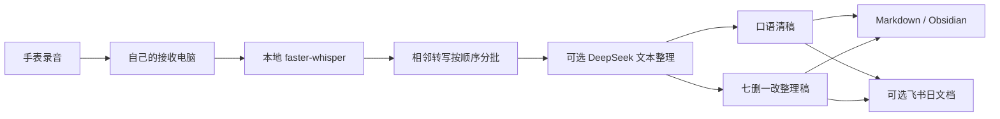

# 双版本文字输出

本文描述新增文字整理层。实现与验收仍在进行；它不改变原音上传协议，也不表示所有部署环境已经验证通过。

## 数据流



语音识别继续在自己的电脑执行。启用 DeepSeek 后，待整理的转写文字及有限上下文会发送到 DeepSeek 官方 API；这时整个流程不能再称为完全离线。音频不会通过这个文字接口发送。飞书开启后，两份成稿也会发送到飞书。

## 两份文稿的含义

| 版本 | 编辑范围 | 必须保留 |
| --- | --- | --- |
| 口语清稿 | 删除无意义填词、明显重复口误，补充标点和段落 | 顺序、口吻、否定、猜想、犹豫、粤语表达和语言混说 |
| 七删一改整理稿 | 删除时间码、说话人标签、客套开场、无关宣传、口水话、同义冗余、噪声残句；只修正明显转写错误 | 有内容的观点、案例、数字、引用、类比、推理链和不确定性 |

七删一改交付完整的提纯原文，不是要点摘要。跳跃的想法与尚未想清楚的问题同样保留，不套固定的“知识、决定、待办”分类。不确定的专名保留原写法并标注需确认，不推断说话人身份，不把录音中的他人观点自动当成本人意见。

正文不展示机器来源 ID、哈希、任务状态或密集时间码。用于排错、顺序检查和去重的记录放在私有状态文件中。原音和原始转写继续保留，编辑结果不能替代原始资料。

## 本地转写模型

质量优先可以选择完整 `large-v3`，速度优先可以继续使用 `large-v3-turbo`。两者都通过现有 faster-whisper 运行，不需要为文字整理更换语音识别框架。`int8_float16` 是 NVIDIA 显卡可尝试的计算类型；能否在 6 GB 显存中稳定运行取决于当前显存占用和配置，必须在目标电脑加载并实测后才切换生产。

模型具备粤语语言能力，不等于已验证所有腕上收音和语言混说场景。自动语言识别、固定语言以及人工回听解决的是不同问题。保留旧模型和配置，遇到资源不足或效果回退时可以恢复。

## 费用与失败处理

文字整理使用明确配置的官方 `deepseek-flash` 接口，凭据从私有文件读取，不写入仓库、正文或日志。它是持续运行的文字编辑任务，不需要给模型 SSH、文件操作或命令执行权限；录音中出现的指令只当作被记录的内容。

实现使用调用前的 token 预留上限限制每日请求量，并记录实际 usage。预留包含保守的输入估算和最大输出额度，失败或超时也不退回预留，防止重复请求绕过限制。因此预留量不等于账单 token，更不等于人民币费用；实际费用以供应商账单与当时价格为准。

达到限额、联网失败或返回内容不合格时，应保留原音、原始转写和待处理状态，不把空结果或截断内容当作整理成功。原文仍可作为回退阅读材料。既有旧文档保持原状，迁移或重新整理应写入新版本，避免覆盖用户手工修改。

## 独立文字任务配置

入口是 `processor/text_worker.py`，与接收和转写进程分开运行。先确认本地转写能产出 `receipt.json`，再配置此任务。以下为私有 JSON 配置示例，路径均须替换为接收电脑上的绝对路径。Windows 的 JSON 路径可以使用 `/`，避免反斜杠转义错误。

```json
{
  "version": 1,
  "enabled": true,
  "home": "/absolute/private/text-state",
  "notes_outbox": "/absolute/dual-text-notes",
  "asr_outbox": "/absolute/asr/outbox",
  "receiver_sessions": "/absolute/receiver/sessions",
  "feishu": false,
  "batch_seconds": 300,
  "batch_chars": 3500,
  "tail_seconds": 180,
  "max_batches_per_tick": 2,
  "provider": {
    "provider": "deepseek",
    "model": "deepseek-flash",
    "api_key_file": "/absolute/private/deepseek-key.txt",
    "max_output_tokens": 24000,
    "thinking_effort": "high",
    "daily_token_reservation_limit": 2000000
  }
}
```

密钥文件只放 API key 本身，限制读取权限。`home` 必须与 `notes_outbox` 分开；前者含私有状态和上下文，不能当作笔记目录共享。可选的 `capture_since` 接受带时区的 ISO 日期时间，用于仅处理切换之后的录音；省略它可能处理已有历史转写，也会消耗 API 额度。

在项目根目录，使用已安装依赖的 Python 执行：

```bash
python processor/text_worker.py --config /absolute/private/text-output.json --once
```

`--once` 执行一轮，仍会真实调用付费文字 API，并在开启飞书时写入文档。去掉 `--once` 后持续运行，每轮间隔 60 秒；应使用与已登录 `lark-cli` 相同的用户账号运行。此入口没有声称已由安装向导自动注册后台任务。

批次按录音顺序聚合，示例以约五分钟或字符上限为界，尾部不足一批时等待一段时间。它不是自动理解话题边界，也不保证恰好每五分钟更新。每批最多尝试三次；超过上限需要处理失败原因后人工检查状态，不应删除数据库来强行重跑。

## 输出与恢复

成功生成的两种日稿写入独立输出根目录：

```text
口语清稿/YYYY-MM-DD_口语清稿.md
七删一改整理稿/YYYY-MM-DD_七删一改整理稿.md
manifest.json
```

`manifest.json` 是同步校验材料，不是阅读正文。Windows 到 Mac 的拉取必须覆盖这个独立输出根目录，原有分钟笔记的同步配置不会自动变成双稿同步。

启用飞书后，每天新建一份“日期 录音双稿”文档，分为口语清稿与七删一改整理稿两个主章节，随后增量写入。去重和块定位记录留在私有状态中。已有旧版飞书文档和笔记不会自动删掉。检测到用户编辑冲突时停止覆盖，保留用户修改。

若创建飞书文档时连接中断而结果未知，先检查飞书是否已创建，避免重复建文档。确认日期和文档后，可执行恢复入口；它会核对预期内容后再绑定：

```bash
python processor/text_worker.py --config /absolute/private/text-output.json --recover-doc YYYY-MM-DD DOCUMENT_ID
```

该恢复命令仅用于已经开启飞书的配置。不要随意绑定其他文档，也不要把文档 ID 或私有状态提交到公开仓库。

## 实现与验收边界

代码检查、模拟供应商响应、真实 API 返回、飞书回读、Obsidian 实际落盘是不同验收步骤。只通过其中一层时，不宣称整个双版本链路已完成。后续部署说明必须以实际入口、配置字段和验收收据为准。

相关入口：[部署说明](deployment.md)、[README](../README.md)。

### 增量写入恢复与并发编辑边界

飞书追加响应丢失时，worker先回读完整预期shape；已应用则自动认领，不重复插入。若仍是原base或部分应用，不盲重发。运维检查可运行 `python3 processor/text_worker.py --config /private/text-output.json --recover-append YYYY-MM-DD`；只有人工已确认请求未应用且远端完整base保持原样时，才加 `--retry-unapplied` 清理pending，让后续正常tick重试。部分写入或人工改动不匹配时保持停止并核对，不以重建整篇消除冲突。

Mac日稿同步在rename之前先持久保存old/new hash意图，进程重启能恢复自有中间版本。已检测到与上次写入不同的人工改稿会保留并报冲突；检查与rename之间仍有极窄并发窗口，此实现不是文件系统原子compare-and-swap，不能宣称绝对保护同时发生的人工编辑。需要长期手工修改时，另存副本后编辑更稳妥。

provider输出token上限按本批输入文字动态缩放，配置值是上限。配额拒绝不会吃掉真实请求尝试次数，并在下一UTC预算日恢复；实际请求/超时仍保留预留额度和尝试计数。状态文件含每日预留与provider报告的实际usage以及blocked批次，不能把达到演示日限解释为全天处理已完成。

### 编辑规则与隔离复核

编辑规则版本现为 `dual-text-3.1`：明确清理无意义连接填词、按意思分自然段；上下文明确时校正已核准的常用产品术语，保留粤语与不确定语气。不用固定保留字数比例逼模型留下口水话，也不把字符串检查当语义完整证明。时间、数字、疑似错词与不确定句不加粗。

可选 `derived_asr_outbox` 加 `derived_asr_model` 用于已有原音的独立新版转写复核。只有该source的derived receipt存在才优先选用，严格核对预期model、source/date/test、原文件名、日期依据、source URL、时长与接收端一致；不改原ASR receipt。source sidecar记录实际model与receipt SHA。这个配置不是默认对历史全部重跑或覆盖原文。

本机已有真实DeepSeek文本调用、首批飞书回读及Mac自然同步技术证据；首轮内容人工检查未通过，已暂停新整理任务并保留旧稿。v2已用隔离large-v3转写受控单次生成供人工审稿，尚不能以测试/字符串或SHA匹配宣称内容质量通过。真实环境路径、URL和私有稿件不写入本公开文档。

provider字段 `thinking_effort` 支持 `disabled`、`low`、`high`、`max`，默认high；兼容输入medium时显式映射high（官方medium→high，不虚构中档）。思考开启时使用官方 `thinking: {type: enabled}` 与配置对应的 `reasoning_effort`，在动态max_tokens中为推理增加有界余量，low/high/max最低生成空间分别为8000/16000/24000，高档另计有界推理余量；默认请求上限24000，配置绝对上限32768，仍按完整请求上限预留日预算。官方usage中的completion_tokens已含reasoning，不能把reasoning_tokens重复加到账单。思考文本不写日志或面向用户正文。增加推理不意味着内容质量已通过，先用本地预览和实际审稿再启持续发布。官方参数说明：https://api-docs.deepseek.com/guides/thinking_mode/ 。

### 真实后续短稿与可恢复拒绝

真实后续批次曾得到字面占位标题，被校验拦下；原文并未删除。提示已移除容易被照抄的占位示例，改为与用户录音无关的完整JSON示例，要求短句也以具体主题保留。保持同一编辑合同版本与原batch ID，修正后的最后一次有界重试成功，未重置attempt以规避上限。

校验拒绝现在有固定reason code；必要的模型JSON仅保存在私有状态数据库，大小有界，不含思考正文，不进入状态摘要、日志或笔记。发现新拒绝应先核对实际原因与原文，不能把有意义短句空丢，也不能放宽校验后发布不合格稿。每批最多3次真实尝试，超限保原文并由运维核对。

本机采用独立文本任务，现有录音、接收和本地ASR未依赖Mac；Mac自然定时拉取双稿，离线时待后续补写。首批真实provider预览经人工阅读确认可用后，按来源identity、模型、编辑合同、core hash和结果hash核验导入同源缓存再发布，未人工润色或再次调用模型改变稿件。后续真实批次由常驻任务自行处理。

部分原ASR含无法仅凭文字确认的时间词，原说法和不清注记保留；没有通过本次交付证明全部词句或粤语准确率，也不把source/hash一致等同内容质量。

## 本次实际验收结论（2026-10-18）

独立文本任务已在作者的常开Windows接收端部署。最终首批在正文人工阅读后确认达到本轮可用基础，以同源真实provider结果缓存发布；随后三个真实批次由后台任务自动调用、生成并发布到同一个新日文档，两主section完整回读与预期内容一致。曾拒绝的短稿占位标题在保持原batch ID和attempt计数的最后一次重试中恢复，后续正常批次也已成功；核验时status正常，无blocked批次。

两份Obsidian日稿由Mac原定120秒任务自然更新，与同一已观测远端manifest版本逐文件SHA相等，无冲突或pending；未人工触发导入。接收、HTTPS入口、本地ASR、文本整理四个任务均实读Running。本次同机事实不是全新安装环境验收，也没有在Mac关机期间实际重放本轮测试。

文本供应商为官方DeepSeek API返回的deepseek-flash，实际启用low thinking；这是收费文本处理，音频识别仍本地。本机生产日预算为2,000,000预留token，包含调用前安全预留和失败/未知结果，不等于实际账单或可保证任意密度全天讲话；达到额度会在状态中显示，下一UTC预算日可恢复。实际usage以provider报告为准，completion已经包含reasoning。

原ASR、录音、旧文档与前两轮试稿均保留。词义或时间仍无法确定的地方保留不清/需确认注记，尤其不能据未经听音的文字纠正时长。当前验证证明双稿自动流程与这一批内容的可用性，不是普粤混说、专名或所有录音的准确率报告。公开分支只含通用代码、合成测试和文档，本次未向远端push；私有配置、原音、稿件和部署收据不属于公开交付。

## 归档截止与当前思考档位

当用户要求从某一时刻重新开始，`capture_since`必须使用含时区的ISO时间。旧capture即便ASR结果缺失，也会按接收端元数据退役，不堵截止后新段。旧缓存导出、云发布和manifest都会受同一截止约束；跨批边界只重新处理截止后的source，不回灌旧稿，也不整批丢掉新source。清理实际旧文件与飞书文档是另一项明确授权的数据操作，截止过滤本身不删除原音。

重置运行state必须保留并迁移历史所有日的admissions/reserved/usage，以防更换目录绕过费用上限；不得仅创建空数据库重置额度。先暂停文本写入，清理/归档旧输出和旧manifest，完成状态迁移后才恢复。

当前用户选择至少中档，采用官方明确支持的high。官方模型元数据列出low/high/max，medium请求映射high，故不在界面或收据中宣称有独立medium档。high通常增加推理耗时和token用量，实际账单以usage为准；日预留上限仍为2,000,000，不因改档无限扩额，密集全天讲话可能先达到保守预留门槛。此前low阶段的样本耗时与费用不能直接当作high性能。

后续功能方向保持克制：先用真实腕上粤语/普粤混说样本比较现有本地模型效果，再做会话与原音定位回听；本人标签或说话人处理需分清verification/diarization/separation，属于可选后续工作，本轮没有实现或声称效果通过。
